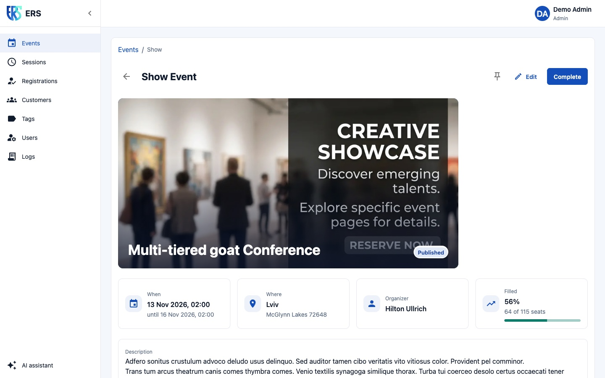
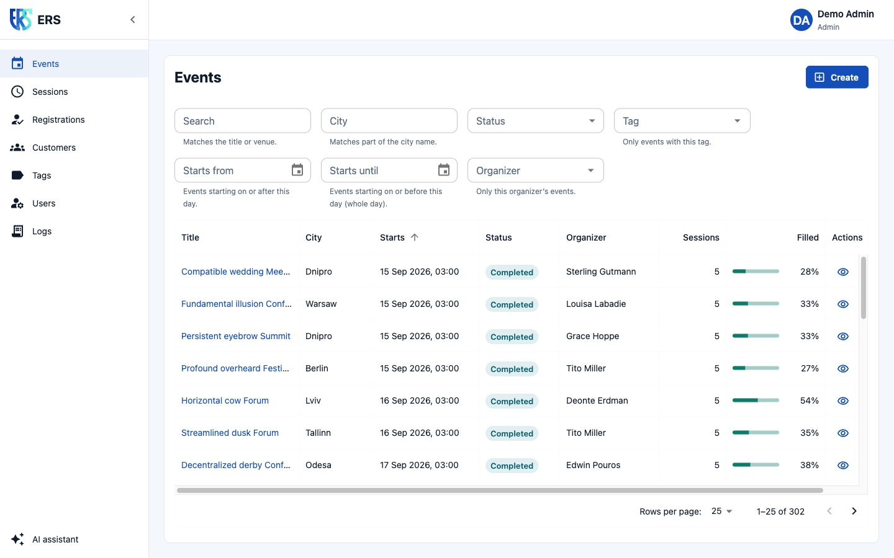

<div align="center">


# Event Registration System

**An admin panel for events, sessions and bookings, with real roles, a waitlist that cannot oversell and an AI assistant that knows the screen you are on.**

[](https://github.com/dns-blsnk/event-registration-system/actions/workflows/ci.yml)
[](https://event-registration-system-plum.vercel.app)
[](https://ers-api-9j21.onrender.com/api/health)


[Live demo](#live-demo) · [Features](#features) · [Why this stack](#why-this-stack) · [Getting started](#getting-started) · [How it works](#how-it-works) · [Deployment](#deployment) · [Tests](#tests)

</div>

<p align="center">
  
</p>

<table>
  <tr>
    <td width="50%"></td>
    <td width="50%">
      <strong>Built on Refine resources.</strong> Server-side pagination, filters and sorting over 300 events, 1500 sessions and 30 000 bookings. Every filter has a helper text from the same field descriptions the AI assistant reads.
    </td>
  </tr>
</table>

## Live demo

| What          | Where                                                                                          |
| ------------- | ---------------------------------------------------------------------------------------------- |
| 🖥️ Admin      | [event-registration-system-plum.vercel.app](https://event-registration-system-plum.vercel.app) |
| 💓 API health | [ers-api-9j21.onrender.com/api/health](https://ers-api-9j21.onrender.com/api/health)           |

Sign up on the sign-in page to get a customer account: browse the catalog, book a session, land on the waitlist when it is full. The staff demo accounts (`owner@demo.test`, `admin@demo.test`, `organizer@demo.test`) are shared together with the submission rather than published here, because they can change the live data.

The API runs on Render's free plan and sleeps when idle: the first request after a pause can take up to a minute, and if it times out, a reload helps.

## Features

- **Events and sessions.** Organizers create events, add sessions with a capacity, publish, complete or cancel them. Events move only `DRAFT → PUBLISHED → COMPLETED` or to `CANCELLED`. Cancelling an event cancels all its registrations.
- **Booking with a waitlist.** A registration is `CONFIRMED` while seats are left and `WAITLISTED` after that. When a confirmed seat is freed, the first person on the waitlist moves up automatically. Seats are taken with a conditional `UPDATE ... WHERE confirmed_count < capacity` inside a transaction, so two people can never get the last seat.
- **Booking rules.** Customers book only published events and future sessions. They can never hold two confirmed seats in overlapping sessions. A session always lies within its event's dates.
- **Computed fields.** Seats left, fill rate per session and per event, total registrations, and an "almost full" filter (90% or more).
- **Roles.** Every route declares its access, and the server scopes every query to what that role may see. The admin hides what you cannot use, from the same permission matrix in `packages/shared`.

  |                   | Admin                                                           | Organizer                                   | Customer                         |
  | ----------------- | --------------------------------------------------------------- | ------------------------------------------- | -------------------------------- |
  | Users             | manage organizers and customers; admins only as **super admin** | –                                           | –                                |
  | Tags              | manage                                                          | read                                        | –                                |
  | Events / sessions | all                                                             | own events only                             | catalog of published events      |
  | Registrations     | all, bulk actions                                               | on own events, bulk "attended" and "cancel" | "My registrations": book, cancel |
  | Customers         | all                                                             | people booked on own events                 | –                                |
  | Logs              | read                                                            | –                                           | –                                |
  | Help chat         | yes                                                             | yes                                         | yes                              |

  A super admin is an admin who, on top, is the only one who can create, demote or delete admins and super admins; the last super admin can never be removed. So one admin can never lock another out.

- **Event banners** in private S3-compatible storage, one fixed 2:1 shape (2160 × 1080, as Eventbrite uses). The form frames the picture in the browser and previews the event header with it; a new event cannot be saved without one, and only drafts may lack one (the API refuses to publish an event without a banner). The API checks the type by content (magic bytes) and size, refuses images under 1200 × 600, then re-encodes every upload with sharp into a 2160 × 1080 WebP: camera metadata such as location is dropped and nothing but pixels is stored. Images are served through short-lived presigned links.
- **AI help chat.** A streamed answer about the field or screen you are on, generated from the same field descriptions the forms use. See [Help chat](#help-chat).
- **Sign-in.** Email and password, or GitHub when it is configured. Self-sign-up always creates a customer; only an admin gives staff roles.
- **Logs page** for admins: every server error and security event with its request id, kept for 7 days.

## Stack

| Part     | Technology                                                                                                        |
| -------- | ----------------------------------------------------------------------------------------------------------------- |
| Monorepo | pnpm workspaces: `apps/api`, `apps/admin`, `packages/shared`, Node 24                                             |
| API      | Nest.js 12, Prisma 7 + PostgreSQL, Socket.IO, nestjs-pino                                                         |
| Admin    | Refine 5 + MUI 6, Vite                                                                                            |
| Storage  | S3-compatible: SeaweedFS locally and in CI, Cloudflare R2 in production                                           |
| Redis    | Short-lived shared state with TTLs: Redis locally and in CI, Render Key Value in production                       |
| AI       | Gemini (Google AI Studio free tier) through the OpenAI-compatible API, streamed; any such API works               |
| Tests    | Vitest; API integration tests against a real Postgres, React Testing Library for the admin, Playwright end to end |
| Hosting  | API and Postgres on Render, admin on Vercel (free plans)                                                          |

### Why this stack

The task is an admin over related data with real rules, roles and a live deploy, so the choice was driven by three things: the data must stay correct under concurrent bookings, access rules must live in one place, and everything must run on free plans.

- **TypeScript end to end, one monorepo.** The API and the admin share `packages/shared`: roles, the permission matrix, error codes, limits and field descriptions are written once. The admin hides exactly what the API refuses, the forms and the AI chat read the same field texts, and a renamed error code breaks the build instead of a screen. _Lost:_ a Python or Ruby admin (Django admin, ActiveAdmin) would give more screens for free.
- **Nest.js.** Guards, modules and dependency injection fit "deny by default": a global guard refuses every route that does not declare `@Public()`, `@SignedIn()` or `@RequirePermission(...)`. Modules give clear boundaries (each exposes only its `index.ts`, enforced by lint). _Lost:_ more ceremony than Express or Fastify alone.
- **PostgreSQL + Prisma.** The booking rules need transactions, row locks, `CHECK` constraints and a conditional `UPDATE` that takes a seat only while one is left. Prisma gives the schema as code, reviewed migrations and typed queries. _Lost:_ a few queries (the "almost full" filter) are less direct than raw SQL would be.
- **Refine + MUI.** The task asks for an admin built with a framework tool, not by hand. Refine gives resources, routing, `useDataGrid` with server-side pagination, filters and sorting, `useForm`, and an `accessControlProvider` that takes the shared permission matrix as is; MUI gives the data grid and form controls. _Lost:_ some screens are custom on top (the banner cropper, the waitlist table with bulk actions, the chat), and Refine's generated defaults had to be replaced there.
- **Server-side sessions in an HttpOnly cookie, not JWT.** A session can be revoked at once (sign-out, role change, deleted user), JavaScript can never read it, and the CSRF token is visible and checked on every write. REST goes through a Vercel rewrite, so the cookie is first-party without buying a domain. _Lost:_ one indexed lookup per request.
- **Socket.IO for the chat.** Answers stream token by token and can be stopped mid-answer. Vercel does not proxy WebSockets, so the socket goes to the API directly and authenticates with a one-time 60-second ticket instead of the cookie.
- **Redis with a TTL on every key.** Chat tickets, chat history, login failure counters and rate limits must agree across API instances; keeping them in process memory would multiply every limit by the number of instances.
- **S3-compatible object storage.** The server's disk is ephemeral on Render and not shared between instances. R2 in production, SeaweedFS locally and in CI, the same code.
- **Gemini through the OpenAI-compatible API.** It has a free tier, and the same client works with any compatible provider by changing `AI_BASE_URL` and `AI_MODEL`.
- **Render + Vercel + Cloudflare R2.** Free plans for everything, managed Postgres and Redis, deploy from GitHub. _Lost:_ cold starts, and the free database expires after about 30 days.

### Project layout

```
apps/api          Nest.js API: src/modules/<feature> (controller → service → Prisma),
                  src/domain (pure business rules), src/common (guards, errors, logging)
apps/admin        Refine admin, Feature-Sliced Design: app → pages → widgets → features → entities → shared
apps/e2e          Playwright browser tests
packages/shared   roles, permission matrix, error codes, limits, field descriptions
```

Business rules that need no database (status transitions, capacity, schedule overlaps, the chat prompt) are pure functions in `apps/api/src/domain`, tested without Nest or Prisma. Services run them inside transactions. Controllers only validate the input, read the current user and call one service method.

## Getting started

Requires Node 24 (`.nvmrc`), pnpm 10 (`corepack enable`) and Docker.

```sh
pnpm install                 # also generates the Prisma client and builds packages/shared
cp .env.example .env         # then fill in SESSION_SECRET and SEED_DEMO_PASSWORD
docker compose up -d         # postgres (5442), postgres-test (5443), Redis (6389), redis-test (6390), S3 (8333) and its bucket
pnpm db:reset                # apply migrations and load demo data (asks nothing, wipes the dev database)
pnpm dev                     # API on http://localhost:3000, admin on http://localhost:5173
```

`SESSION_SECRET` needs at least 32 random characters (`openssl rand -hex 32`); `SEED_DEMO_PASSWORD` must be 10 to 128 characters. The seed creates four demo accounts that all use `SEED_DEMO_PASSWORD`: `owner@demo.test` (super admin), `admin@demo.test`, `organizer@demo.test` and `customer@demo.test`, plus events, sessions, registrations and banners.

The chat needs `AI_API_KEY` (a Gemini key from [Google AI Studio](https://aistudio.google.com/api-keys); `AI_BASE_URL` and `AI_MODEL` switch to another OpenAI-compatible provider, with `AI_REASONING_EFFORT=default` for models that have no reasoning, and `AI_STREAM_USAGE=false` for an API that refuses the token-count option); without it the widget says the assistant is unavailable and everything else works. GitHub sign-in needs `GITHUB_CLIENT_ID` and `GITHUB_CLIENT_SECRET` (callback `http://localhost:5173/api/auth/github/callback`); without them the button is hidden.

### Scripts

| Command                             | What it does                                                                                                                                                                                |
| ----------------------------------- | ------------------------------------------------------------------------------------------------------------------------------------------------------------------------------------------- |
| `pnpm dev`                          | API and admin in watch mode                                                                                                                                                                 |
| `pnpm lint` / `pnpm lint:fix`       | ESLint (strict type-checked rules, size limits)                                                                                                                                             |
| `pnpm format` / `pnpm format:check` | Prettier                                                                                                                                                                                    |
| `pnpm typecheck`                    | TypeScript in every package                                                                                                                                                                 |
| `pnpm test`                         | All tests; API integration tests use `postgres-test`                                                                                                                                        |
| `pnpm test:e2e`                     | Playwright browser tests: seeds a fresh `ers_e2e` database on `postgres-test`, then runs the built API and the admin (first run: `pnpm --filter @ers/e2e exec playwright install chromium`) |
| `pnpm build`                        | Build every package                                                                                                                                                                         |
| `pnpm db:reset` / `pnpm db:seed`    | Recreate the dev database / load demo data                                                                                                                                                  |
| `pnpm db:seed:banners`              | Give every event already in the database one of the demo banners, without touching other data                                                                                               |

## How it works

### Requests, sessions and CSRF

The admin calls the API on its own origin: `/api/*` goes through the Vite proxy locally and a Vercel rewrite in production. The session cookie is therefore first-party, `HttpOnly`, `SameSite=Lax` and, in production, `Secure` with the `__Host-` prefix. Only the SHA-256 of the session token is stored. Sessions last 7 days with a 24-hour idle timeout, and signing in always starts a new one.

Every state-changing request carries the session's CSRF token in `X-CSRF-Token`, compared in constant time. Passwords are hashed with argon2id. Login failures are limited both per client and per account. Request rate limits, login counters and the chat question limit live in Redis, so they hold across API instances instead of multiplying by their number. If Redis is down, the broad per-IP request limit lets requests through so the admin keeps working, while sign-in and the chat refuse rather than skip their limits. `/api/health` is not throttled, so it still answers.

### Errors

Expected failures are `DomainError`s with a code from `packages/shared`. A single exception filter turns every error into `{ statusCode, code, message, details?, requestId }` and never sends a stack trace. The admin shows the request id with the error, so a user can pass it on and it can be found on the Logs page.

### Logging

- **stdout** (Render Logs): one JSON line per request from nestjs-pino, plus business events at `info`.
- **`AppLog` table** (Logs page): server errors (5xx, failed or crashed chat answers) and security events (failed logins, forged or unknown session tokens, 403, CSRF failures, 429, rejected uploads, refused chat connections). A missing or expired session is routine and is not journalled. Ordinary 4xx answers stay in stdout only.
- Writes are buffered and flushed in batches, so logging never slows down or breaks a request, and entries survive a short database outage. There is a per-minute cap against floods.
- Passwords, cookies, session ids, CSRF tokens, chat tickets, API keys, request bodies and chat text are never logged.
- Entries older than 7 days are deleted every day and on start (a free instance may sleep through the scheduled run). If volume grows, the next step is daily partitions that are dropped instead of deleted.

### Help chat

The widget connects to the API over Socket.IO with a one-time ticket from `POST /api/chat/ticket` (60 seconds, bound to the user and session, stored in Redis as a hash and spent atomically, so any API instance accepts it once). The API checks the origin, the ticket and a live session. It re-checks the session and the current role before every question, and closes sockets whose session has ended.

The instructions are built from the shared field descriptions and domain rules of every list the user's role may open, and nothing else. The screen the user is on and the current time in their zone travel with each question as a short note from the panel, so the instructions and the chat before the question stay the same between questions and a provider with prompt caching can reuse them. Data comes from read-only tools that call the same services, with the same role scoping, as the REST API. A search gives the model at most 10 rows and the total, and the rows of lookups older than the latest one are left out of later requests (the chat kept in Redis stays whole). Every answer logs its prompt, completion and cached tokens.

The answer streams back and can be stopped. Each user may ask 10 questions a minute, counted across all their sockets and API instances.

In production the socket connects to the API host directly (`VITE_CHAT_URL`), because Vercel rewrites do not carry WebSockets.

## Deployment

CI (`.github/workflows/ci.yml`) runs lint, format check, typecheck, all tests against Postgres, Redis and S3 containers, the build and then the Playwright browser tests against a freshly seeded database, on pushes to `main` and `dev` and on every pull request. Locally, `pnpm test:e2e` runs the browser tests. Deploy (`.github/workflows/deploy.yml`) runs only after a green CI run of a push to `main`:

1. It asks Render to deploy that exact commit.
2. It waits until `/api/health` reports that commit with the database and Redis up.
3. It deploys the admin to Vercel.
4. It checks that the admin and its `/api` rewrite answer.

Until the deploy settings exist, the workflow skips itself. If only some settings exist, it fails.

### One-time setup

1. **Render.** Create a Blueprint from `render.yaml`. It creates the `ers-api` Docker service (migrations run on start), the `ers-db` Postgres and the `ers-kv` Key Value (Redis-compatible, reachable only from Render services). Then fill in the values marked `sync: false`:
   - `ADMIN_ORIGIN`: the Vercel URL;
   - `S3_ENDPOINT`, `S3_BUCKET`, `S3_ACCESS_KEY_ID`, `S3_SECRET_ACCESS_KEY`: Cloudflare R2, a private bucket and an API token limited to it;
   - optionally `AI_API_KEY`, `GITHUB_CLIENT_ID` and `GITHUB_CLIENT_SECRET`.

   `SESSION_SECRET` is generated by Render. Copy the deploy hook URL.

2. **Vercel.** Import the repository with Root Directory `apps/admin`. `apps/admin/vercel.json` sets the build, the `/api` rewrite, the CSP and security headers, and `VITE_CHAT_URL`.
3. **API host.** `vercel.json` names the API host once, `ers-api-9j21.onrender.com`. If Render gives the service a different URL, change it there; a test checks that the rewrite, CSP and chat URL agree.
4. **GitHub OAuth app** (optional). Callback `https://<admin-domain>/api/auth/github/callback`.
5. **GitHub repository settings.**
   - Secrets: `RENDER_DEPLOY_HOOK_URL`, `VERCEL_TOKEN`, `VERCEL_ORG_ID`, `VERCEL_PROJECT_ID`.
   - Variable: `ADMIN_URL`.

## Tests

| Package           | Tests | What they cover                                                                                                                                                                                |
| ----------------- | ----- | ---------------------------------------------------------------------------------------------------------------------------------------------------------------------------------------------- |
| `apps/api`        | 1086  | Unit tests for the domain rules; integration tests for every endpoint against a real Postgres, Redis and S3: each role on each resource, CSRF, cookies, uploads, chat                          |
| `apps/admin`      | 435   | Pages, forms, access control and the chat widget with React Testing Library                                                                                                                    |
| `packages/shared` | 158   | The permission matrix, field descriptions and shared validation                                                                                                                                |
| `apps/e2e`        | 5     | In a real browser: an organizer publishes an event with a framed banner and a session; a new customer books a seat; only the super admin manages admins; a customer is kept out of staff pages |

The tests target what would hurt most if it broke: who may see and change what (every role against every resource), the booking rules (a race test sends parallel bookings at the last seat and checks that capacity is never exceeded), and the security edges (CSRF, session revocation, forged tickets, file type by content). Integration tests never mock Prisma: a test that passes against a mock can still fail against a real transaction.

## What I deliberately left out

- **Email.** No email verification, password reset or notifications (for example when someone moves up from the waitlist): they need a mail provider and a domain. Because emails are not verified, GitHub sign-in never links to an existing account by email.
- **Payments and tickets.** A registration is a seat in a session, nothing more. Pricing would add a payment provider and refunds without showing anything new about the admin.
- **A repository layer over Prisma.** Services use Prisma directly; another abstraction would only wrap the same calls.
- **Sentry or another error tracker.** Server errors and security events go to stdout and to the `AppLog` table with the request id, which an admin reads on the Logs page. One less external account and secret.
- **Live updates in the admin.** Lists refresh on navigation and after your own changes, not when someone else books a seat. Only the chat uses a socket.
- **Translations.** The admin is in English only.
- **A custom domain.** The `vercel.app` and `onrender.com` addresses work, and a domain can be added later through environment variables only.

## Known limitations and next steps

- **Direct calls to Render.** `TRUST_PROXY_HOPS=2` counts the Vercel and Render proxies. A client calling the `onrender.com` URL directly can forge its IP, which weakens per-IP rate limits. Login lockout also counts per account (20 failures per 15 minutes), which still bounds password guessing, at the cost that anyone can briefly lock out a known email. A shared secret header from the rewrite would close the IP gap.
- **Free Render plan.**
  - The Postgres database expires after about 30 days, so a lasting deployment needs a paid database.
  - An idle instance sleeps; the first request after a pause can time out at the Vercel proxy and needs a retry.
  - The Key Value instance keeps nothing on disk and Render may restart it at any time. Every key there is short-lived, so a restart only costs a new chat ticket, reset login failure counters and rate limits, and an empty chat history.
- **Sign-in needs Redis.** Every attempt is counted in Redis before the password is checked, so parallel guesses cannot slip past the lockout. If Redis is down, sign-in answers 503 rather than checking passwords without the lockout.
- **"Almost full" filter.** It runs two queries rather than one. A single query would need a generated column, and the 90% threshold would then live both in a migration and in `packages/shared`.
- **Waitlist after a conflict.** A waitlisted customer skipped because of an overlapping booking is promoted at the next change in that session, not immediately when the conflict disappears.
- **GitHub and existing accounts.** GitHub sign-in never links to an existing account with the same email, because sign-up does not verify emails. An existing user cannot add GitHub to their account.

## With more time

1. **More browser tests.** The Playwright suite covers publishing an event, booking and roles; it would grow to cover the waitlist moving up, bulk actions and the AI chat.
2. **A paid database and an always-on API instance.** They remove the 30-day database expiry and the cold start, the two things a reviewer is most likely to hit.
3. **A shared secret between the Vercel rewrite and the API**, so direct calls to Render are refused and per-IP limits cannot be bypassed.
4. **Email** through a provider: verified sign-ups (which would allow linking GitHub to an existing account), password reset and a message when a waitlisted customer gets a seat.
5. **At 10x traffic:** cache the public catalog for a few seconds, move the waitlist promotion to a queue so a cancellation answers at once, and add read replicas for the heavy lists. The seat counter is already a single conditional `UPDATE`, so bookings themselves do not need locks that grow with traffic.
